# 🛡️ Awesome-Managed-Identity-Threat-Protection

  

  
  
  
  
  
  

---

## 🎯 Top Managed Identity Threat Protection Ecosystem

**A Curated Enterprise List of Managed ITDR SaaS Platforms & Open-Source Security Tools**  
*Focused on 24/7 Managed ITDR, Identity Attack Surface Reduction, Non-Human Identity (NHI) Security & Active Directory / Cloud Identity Threat Detection*  

📅 **Last updated: November 2026**

This repository tracks premier **SaaS platforms** and essential **open-source projects** in the **Managed Identity Threat Protection** and **Identity Threat Detection and Response (ITDR)** landscape. These enterprise solutions empower SecOps and Identity teams to detect, investigate, and surgically remediate identity-driven attacks—such as credential theft, Kerberoasting, golden ticket forgery, privilege escalation, lateral movement, session hijacking, and multi-factor authentication (MFA) fatigue—before threat actors establish persistence or compromise critical cloud and directory systems.

---

## 📊 Sector Overview & Market Dynamics

The global **Identity Threat Detection and Response (ITDR)** and Managed ITDR sector is valued between **$7.27 billion and $20.45 billion in 2026**, on an aggressive growth trajectory projected to surpass **$42.7 billion by 2030** (CAGR ~22.6%). The market exhibits **moderate fragmentation with high concentration among established cybersecurity giants**: core endpoint and identity juggernauts (CrowdStrike, CyberArk, BeyondTrust) capture large enterprise footprints, while specialized pure-play innovators (Silverfort, Semperis) and elite MDR providers (Arctic Wolf, Expel, Red Canary, Vectra AI) command high defensibility through proprietary inline telemetry, agentic AI triage, and dedicated 24/7 human Concierge SOC expertise.

---

## 📑 Table of Contents

- [📊 Sector Overview & Market Dynamics](#-sector-overview--market-dynamics)
- [☁️ SaaS / Hosted Platforms](#️-saas--hosted-platforms)
- [🔓 Open-Source GitHub Projects](#-open-source-github-projects)
- [🤝 How to Contribute](#-how-to-contribute)
- [⚠️ Disclaimer](#️-disclaimer)
- [📈 Star History](#-star-history)
- [💖 Support & Sponsorship](#-support--sponsorship)

---

## ☁️ SaaS / Hosted Platforms

Below is the comparative breakdown of premier commercial SaaS and Managed ITDR platforms, sorted in descending order by **company size (market capitalization / enterprise valuation)**.

| SaaS Product | Valuation / Revenue | Pricing Model & Starting Tier | Free Tier / Free Trial Limits | Key Capabilities & Highlights |
| :--- | :--- | :--- | :--- | :--- |
| **[CrowdStrike Falcon Complete Identity Threat Protection](https://www.crowdstrike.com/)** | **~$260B Market Cap** (~$4.8B TTM Revenue) | From **~$4.00/user/mo** ($48/user/yr) for Falcon Identity module add-on; Falcon Enterprise base tier starts at **$184.99/endpoint/yr**; Falcon Complete 24/7 MDR add-on quoted based on seat tier | **15-Day Free Trial** (Falcon Prevent/Insight endpoint & identity trial for up to 50 endpoints; no perpetual free tier) | The first fully managed 24/7 ITDR solution. Combines Falcon Identity Threat Protection technology with Falcon Complete SOC analysts who surgically isolate compromised credentials and stop lateral movement in real time. |
| **[CyberArk](https://www.cyberark.com/)** | **~$20.5B Market Cap** (~$1.3B+ TTM Revenue) | Baseline SaaS Privileged Access Manager starts at **~$1,788/privileged user/yr** (AWS Marketplace entry pack for 25 users); Identity Security Web SSO & MFA starts from **$2.00–$5.00/user/mo** | **30-Day Free Trial** (CyberArk Privilege Cloud / Identity Security trial for testing up to 50 users/assets; no perpetual free tier) | Market leader in human and non-human machine identity security. Features MSP Hub, unified PAM, CIEM, ITDR, and Identity Governance & Administration (IGA). |
| **[Arctic Wolf](https://arcticwolf.com/)** | **~$4.3B Valuation** (~$430M+ ARR) | MDR Basic starting tier published at **$44,000/year** (AWS Marketplace, covering up to 100 users/assets); comprehensive enterprise tiers range from **$190–$260/user/yr** | **No Free Tier** (Structured interactive guided demo / customized proof of concept [PoC] available for enterprise qualifications; no unguided self-service free trial) | 24/7 SOC monitoring paired with a named Concierge Security Team delivering proactive identity posture hardening, credential exposure scanning, and integrated MDR cross-telemetry. |
| **[Sophos](https://www.sophos.com/)** | **~$3.9B Valuation** (~$1.0B Revenue) | Sophos MDR starts at **$239.64/user/yr** on AWS Marketplace; Sophos ITDR integration packs and baseline endpoint telemetry included at no additional licensing surcharge | **30-Day Full-Featured Free Trial** (Includes complete Sophos Central, Intercept X Advanced with XDR/MDR capabilities for up to 100 endpoints/users; no perpetual free tier) | MDR with native Sophos ITDR add-on. Analysts monitor dark web credential breaches, detect anomalous Entra ID and Active Directory privilege escalation, and remediate on the customer's behalf. |
| **[BeyondTrust](https://www.beyondtrust.com/)** | **~$1.5B+ Valuation** (~$400M+ ARR) | Endpoint Privilege Management starts at **~$40–$75/endpoint/yr**; Password Safe / PAM starts from **~$500–$900/asset/yr**; Remote Support concurrent technician starts at **~$1,900/mo** | **21-Day Free Trial** (Password Safe / Privileged Remote Access evaluation license for 5 users/assets; no perpetual free tier) | AI-driven Pathfinder Platform integrating PAM, ITDR, CIEM, and Just-in-Time (JIT) access governance following the acquisition of Entitle. |
| **[Vectra AI](https://www.vectra.ai/)** | **~$1.3B Valuation** (TCV/Blackstone funded) | Vectra AI Base Platform starts at **$499.00/unit baseline** via AWS Marketplace; enterprise hybrid cloud & identity NDR contracts typically range from **$8.00–$22.00/IP/yr** (~$150k+/yr mid-market baseline) | **30-Day Free Trial / Cloud Threat Proof-of-Value** (Full cloud identity and Microsoft 365 / Entra ID threat assessment scan; no perpetual free tier) | AI-driven Attack Signal Intelligence correlating attacker TTPs across hybrid cloud, Entra ID, M365, and network telemetry to prioritize critical identity hijacking. |
| **[Silverfort](https://www.silverfort.com/)** | **~$1.0B Valuation** (~$100M+ ARR) | Tiered platform licensing starting from approximately **$700–$800/user/yr** (Core tier covering ISPM & Universal MFA; Advanced & Enterprise tiers add ITDR & Non-Human Identity protection) | **14-Day Enterprise Evaluation** (Free POC / tenant scan of Active Directory and cloud identity attack surface; no perpetual free tier) | Patented Runtime Access Protection (RAP) enforcing inline MFA and access firewalls directly at the authentication layer across legacy and modern hybrid directories without agents. |
| **[Semperis](https://www.semperis.com/)** | **~$1.0B+ Valuation** (~$100M+ ARR) | Directory Services Protector (DSP) and Active Directory Forest Recovery (ADFR) enterprise subscriptions start from **~$15–$30/user/yr**; custom quotes based on directory object count | **100% Free Forever Community Tier: Purple Knight & Forest Druid** (Unlimited manual point-in-time security assessment scans across AD, Entra ID, and Okta; commercial DSP includes a 30-day PoC) | Identity resilience and crisis recovery leader. Hardens directory infrastructure, detects active Active Directory attacks, and provides point-in-time rollback with dedicated out-of-band disaster recovery. |
| **[Expel](https://expel.com/)** | **~$1.0B Valuation** (~$100M+ ARR) | Expel MDR annual packages start from **$75,000/yr** (Select tier mid-market entry on AWS Marketplace); enterprise MDR with full identity telemetry ranges up to **$150k–$300k+/yr** | **14-Day Free Guided PoC** (Expel Workbench connection to Okta, Entra ID, and Duo with live alert triage simulation; no unmanaged perpetual free tier) | Transparent MDR with agentic AI ('Ruxie') that investigates and scores identity alerts in under 30 seconds while SOC analysts auto-contain compromised sessions and push-bomb attacks. |
| **[Red Canary](https://redcanary.com/)** | **~$600M Valuation** (Part of Zscaler MDR) | Public AWS Marketplace rate card starts at **$100.00/user account/yr** (MDR Identity) and **$120.00/endpoint/yr**; multi-year enterprise commitments available | **30-Day Free Trial** (Proof-of-Value deployment into identity and endpoint environments; no perpetual free tier) | MDR with customer-validated 99% threat accuracy, GenAI investigation flows reducing MTTR by 60%, and integration with Palo Alto Cortex XSIAM. |

---

## 🔓 Open-Source GitHub Projects

The open-source ecosystem provides identity attack-graph analyzers, tenant reconnaissance engines, posture audit scanners, and self-hosted investigation frameworks. Note that open-source tooling provides **the software, not the 24/7 human SOC team**.

Projects below are sorted in descending order by **GitHub_Stars_Count**:

| Open-Source Project | GitHub_Stars_Badge | Primary ITDR Focus Area | Key Architecture & Features |
| :--- | :--- | :--- | :--- |
| **[Prowler](https://github.com/prowler-cloud/prowler)** |  | Cloud Identity Posture & Security Assessment | Over 300+ automated security controls for AWS, Azure, Microsoft Entra ID, and GCP. Evaluates CIS benchmarks, privilege escalation vectors, unused credentials, and dangerous IAM policies. |
| **[SpecterOps BloodHound](https://github.com/SpecterOps/BloodHound)** |  | Attack Path Management & Identity Graph | Uses graph theory to uncover hidden privilege escalation paths and unintended trust relationships in on-premises Active Directory and Microsoft Entra ID (AzureHound). |
| **[dirkjanm ROADtools](https://github.com/dirkjanm/ROADtools)** |  | Microsoft Entra ID Exploration & Token Ops | Framework for exploring Entra ID tenants via `ROADrecon` (local SQLite/web UI representation of directory relationships) and `roadtx` for PRT authentication and device token manipulation. |
| **[Azure Stormspotter](https://github.com/Azure/Stormspotter)** |  | Azure & Cloud Identity Attack Graph | Official Microsoft Red Team tool generating directed attack graphs of Azure subscriptions, resources, role assignments, and Entra ID service principals into a Neo4j database. |
| **[CISA Sparrow](https://github.com/cisagov/Sparrow)** |  | Forensic Triage & Identity Threat Investigation | Created by CISA to detect compromised accounts, anomalous tenant PowerShell executions, and malicious federated domain modifications in Microsoft Azure and M365 environments. |
| **[Mandiant Azure AD Investigator](https://github.com/mandiant/Mandiant-Azure-AD-Investigator)** |  | Incident Response & IOC Directory Analysis | PowerShell tool designed by Mandiant IR teams to identify risky configurations, compromised service principals, backdoor credentials, and suspicious tenant trust settings. |
| **[nicolonsky ITDR](https://github.com/nicolonsky/ITDR)** |  | Community ITDR Detections & Hunting Rules | Curated collection of threat hunting KQL queries, Sentinel detection playbooks, and Microsoft Defender for Identity attack technique demonstrations. |
| **[Semperis PK-AADAppReg](https://github.com/Semperis/PK-AADAppReg)** |  | Entra ID App Registration & Assessment Helper | Open PowerShell utility that provisions least-privilege delegated application registration permissions for Purple Knight assessments across Microsoft Entra ID. |
| **[Noble-Effeciency13 M365IdentityPosture](https://github.com/Noble-Efffeciency13/M365IdentityPosture)** |  | Microsoft 365 Posture Assessment Scripting | Read-only PowerShell security reporting tool assessing Authentication Context Inventory, Conditional Access enforcement, and Privileged Identity Management (PIM) hygiene. |
| **[Authomize OpenITDR](https://github.com/authomize/Open-ITDR)** |  | Community ITDR API Standard & Playbooks | Community framework defining open schema standards for identity threat detection, Node-RED automation workflows, and remediation playbooks for SaaS and cloud environments. |
| **[scienstien ThreatFlix](https://github.com/scienstien/threatFlix)** |  | Explainable AI Identity Threat Copilot | Research prototype utilizing Gemini LLMs and deterministic attack graphs to translate raw identity telemetry into explainable MITRE ATT&CK incident investigations. |

---

## 🤝 How to Contribute

Contributions are warmly welcomed! Help us keep this directory up-to-date and accurate:

1. 🍴 **Fork** this repository.
2. 🌿 Create your feature branch (`git checkout -b feature/new-identity-solution`).
3. 📝 Add or refine verified SaaS or open-source entries following the tabular format above.
4. 🚀 Commit your improvements (`git commit -m 'feat: add new ITDR solution'`).
5. 📬 Open a **Pull Request** explaining your suggested additions and providing links to official documentation or source code.

Please ensure all pricing disclosures, trial terms, and repository links remain factual and strictly grounded.

---

## ⚠️ Disclaimer

- This list is **community-curated** for educational, architectural, and evaluation purposes; it does not constitute an endorsement or commercial warranty.
- **Open-source cannot replicate a managed identity threat protection service**: Managed ITDR fundamentally relies on human SOC teams providing 24/7 detection, live forensics, and surgical containment. Open-source repositories deliver attack-path graphing, policy auditing, and API schemas—not the continuous human team.
- Pricing figures, licensing models, and trial policies change frequently; always consult each vendor's authorized rate card and official cloud marketplace listings before procurement.

---

## 📈 Star History

---

## 💖 Support & Sponsorship

If this curated guide helps streamline your identity security architecture, threat detection roadmap, or vendor evaluation, please consider supporting the project:

- ⭐ **Star this repository** to improve discoverability!
- 🍴 **Fork and share** it with fellow cybersecurity engineers, SOC analysts, and IAM professionals.
- ☕ **Buy us a coffee or become a sponsor**: support ongoing open-source curation and cybersecurity maintenance directly through the [GitHub Sponsor Dashboard](https://github.com/sponsors/ishandutta2007).

Thank you for contributing to an identity-first, zero-trust security community! 🛡️
